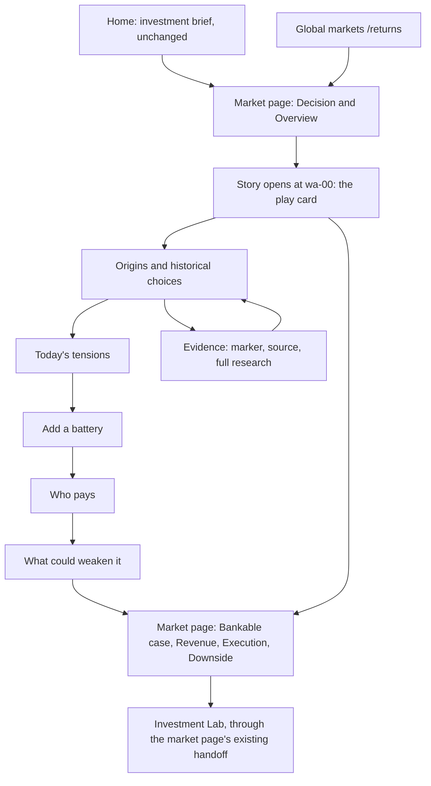

# Experience and Page Design

Pack: BESS-IX-2026-10-30, version 1.2  
Status: information architecture and layout brief; no website or UI implementation  
Navigation: [Master plan](README.md) | [WA storyboard](western-australia-storyboard.md) | [Content contract](evidence-and-content-specification.md#5-proposed-story-content-contract) | [Engineering work](engineering-work-packages.md)

## 1. Where the story lives

The platform already answers three questions on three pages, per the 26 October three-page design (REPO-13): where to invest (home), why this market (`/returns`) and how to execute (the market page). The story does not add a fourth path. It explains the call that the market page already states.

**Entry.** The market page's Overview section has a "Grid, history and full research context" button that lazy-loads the research dialog (`src/experience/pages.js`, `researchDialog.js`). In v1.1 that button opens the story for markets that have one, and the full research stays one click deeper inside it. Markets without a story keep today's dialog.



Proposed story URL: `/markets/western-australia?view=story&chapter=tensions&shot=wa-06`. It is not implemented yet; `WP-04` owns it.

**Home stays unchanged in the pilot.** It is conclusion-first by design and had about 2.5 KiB of first-view budget left at PR #69 (262.5 of 265 KiB, REPO-14). Story invitations on the home page, grouped as Wrong time, Wrong place and Need for response, are a later option and must load lazily.

## 2. Page inventory

| Surface | Today | Change in the pilot |
| --- | --- | --- |
| Home (`/`) | Investment brief | None |
| Global markets (`/returns`) | Matrix and side-by-side comparison | None; a per-market story link can follow the pilot |
| Market page (`/markets/:slug`) | Decision, Overview, Revenue drivers, Bankable case, Revenue, Execution, Special opportunity, Downside, Sources | The Overview's research button opens the story; every story chapter links back to these sections |
| Research dialog | Lazy dialog with the full research | Becomes the story's container, with the full research as its deepest layer |
| Investment Lab | Cross-market underwriting and saved cases | None; reached through the market page's existing handoff |
| `/data`, `/changes`, `/news`, `/scout`, `/desk` | Independent routes | None |

No onboarding questionnaire, account system, CMS or navigation redesign.

## 3. Layout

### Desktop

About 40% text and 60% scene where the width allows. One question, one change and one meaning per shot. The scene may stay in view within its chapter but never takes over scrolling.

```text
Western Australia / WEM-SWIS             [Play card: call · play · next action]
Story  |  Go to the investment case

03 / Today's tensions                    [Isometric SVG scene or signature chart]
Why does WA pay for long batteries?      [Labels and legend as real text]
One short answer.                        [One control]
Fair · What would change it: …
Investment meaning, in one line

Previous   Next   Chapters   Sources   Go to the investment case
```

### Mobile

One visual, one explanation, one control, in normal vertical flow. The visual takes about half the screen. Tables become grouped cards. No pinching and no nested scroll panels.

```text
Market / Chapter
Question
[Scene or chart]
One control
Short answer
Fair · What would change it
Previous   Chapters   Next
Go to the investment case
```

## 4. Visual system

Reuse the existing tokens (REPO-07) and the three-page design's palette rather than adding new colours.

| Element | Rule |
| --- | --- |
| Palette | Off-white `#f5f3ed`, near-white panel `#fffefa`, deep green `#224e40`, ink `#193c32`, pale lime `#dce6b7`; gold for opportunistic, copper for downside |
| Typography | Serif headings, sans-serif body, tabular figures; story body 16 to 18 px, at least 16 px on mobile |
| Scenes | Isometric SVG on a 2:1 projection, from one shared kit of about 20 symbols: generator, transmission line, substation, homes, industry, rooftop solar, wind, battery, interconnector, transformer, power conversion, controls, meter, sun and moon. Flat fills with one shade per face. Drawn in-house, so no third-party licence is needed |
| Semantic colour | Stable colours for generation, load, storage and constraint, separate from market series and risk ramps, always paired with a label or pattern |
| Time of day | Day, dusk and night through colour tokens on the same drawing; labels never fade out |
| Scenarios and examples | Future or scenario assets dashed; teaching values tagged "Example"; observed data solid |
| Evidence marker | One Strong, Fair or Thin chip per shot plus a "What would change it" line. No disclaimer bands and no caveat paragraphs |
| Signature chart | One per market, flat 2D, with units and dates on the axes |
| Finance | The story shows only the play card; every other figure stays in the market page's existing charts |
| Motion | Short CSS transitions on user action only; none under reduced motion; no autoplay |
| Themes | Keep the existing theme preference; check scenes and charts in each theme |

Touch targets of at least 44 by 44 CSS pixels, visible focus, and no meaning carried by colour alone.

## 5. Components

| Component | Behaviour | First use |
| --- | --- | --- |
| Play card (existing) | Call, play, the figures the card already shows, and the next action, from the briefing model | wa-00 |
| Story shell | Question, copy, scene, marker, meaning and chapter navigation | Every shot |
| Chapter navigator | Direct jump, previous and next, history entries, keyboard support | Every chapter |
| Isometric stage | Renders a scene from symbol IDs and layout anchors, applies teaching state, keeps labels as text | wa-01 to wa-09 |
| Signature chart | One data-backed chart per market | wa-06 |
| Timeline node card | Constraint, choice, what remains, effect today; event and interpretation kept apart | wa-03 |
| Cutaway with hotspot list | Exploded SVG layers; function, limits and evidence status per part | wa-09 |
| Payment path | Route, payer, qualification, obligation, settlement | wa-10 |
| Allocation board | Teaching conflict versus project unknown | wa-11 |
| Evidence marker and source link | Strong, Fair or Thin; what would change it; source and date; a link into the full research | Every shot |
| Glossary term | Plain meaning first, acronym second | Throughout |

Keep content independent of the drawing code, so text, scenes and charts all read the same approved meaning.

## 6. Plain-language glossary

Write each idea plainly before its acronym. The third column keeps the copy accurate for authors; it is never printed as a caveat.

| Term group | Plain explanation | Author's boundary |
| --- | --- | --- |
| MW, MWh, duration, SOC | Delivery rate, stored energy, nominal hours, remaining usable energy | Nameplate energy differs from deliverable energy after limits and losses |
| Operational demand, net load | What remains for the grid's own resources after rooftop and other embedded supply | Definitions vary by dataset |
| Energy shifting | Absorb energy at one time and return less of it later | Value depends on prices, charging rights, costs and restrictions |
| Response, reserve, system service | Be ready to change output quickly under set requirements | Purpose, direction, activation and duration differ by product |
| Capacity payment | Payment for a certified ability to deliver when needed | Not unlimited, and not a guarantee of debt service |
| Qualification, certification | Proving the right capability and meeting participation rules | Capability, application, approval, award and ongoing compliance are separate steps |
| RTB, construction, energisation, COD | Milestones from ready-to-build to commercial operation | Commercial operation does not start every payment at once |
| Fixed, renewal, merchant | Revenue that is contracted, re-contracted or market-exposed | A model assumption is not a signed contract; expiry leaves a tail |
| Grant | Capital support with conditions | An award is not a receipt, and a grant is not operating income |
| All-equity and levered IRR | Returns before and after a defined financing structure | Entry price, cash-flow clock and exit assumptions matter |
| Downside, DSCR, exit | A stress case, debt-service cover and sale exposure | Not a probability, a lender commitment or a guaranteed sale |

## 7. Two languages

The site needs complete English and Simplified Chinese for copy, controls, labels, captions, markers, chart axes and error states. Use stable IDs and reviewed locale entries. Scene text comes from the story content: each shot's `labels`, keyed English and Chinese pairs in the market's content file (`src/markets/wa/story.js`), with ‹bound› tokens filled from the model. It is never baked into a drawing. Source titles keep their original language. Switching language keeps the market, chapter, shot and reading position. The user checks both languages at each sign-off, and a translation that changes an obligation goes back to mechanism review.

## 8. States

| State | Behaviour |
| --- | --- |
| Story loading | Text first; the scene fills in without shifting the layout |
| Reduced motion | Instant changes |
| Data stale or missing | Last vintage with its date, or "not available"; qualitative copy stays; the marker drops a level |
| Evidence opened and closed | Focus moves into the panel and returns to its trigger; position kept |
| Market without a story | The research dialog as today |
| Call changed since the story was signed off | The play card shows the new call; one line says when the story was last reviewed, until the user re-signs it |

## 9. Design deliverables

Before building, prepare annotated desktop and mobile views of wa-00, wa-03, wa-06 (the signature chart), wa-09 (the cutaway) and wa-10 (the payment path); a sheet of the symbol kit; and one day-and-dusk sample. Mark each as a sketch, wireframe, static design or implemented screenshot. The screen widths to check are listed in [the acceptance plan](preparation-migration-and-acceptance.md#5-self-review).
