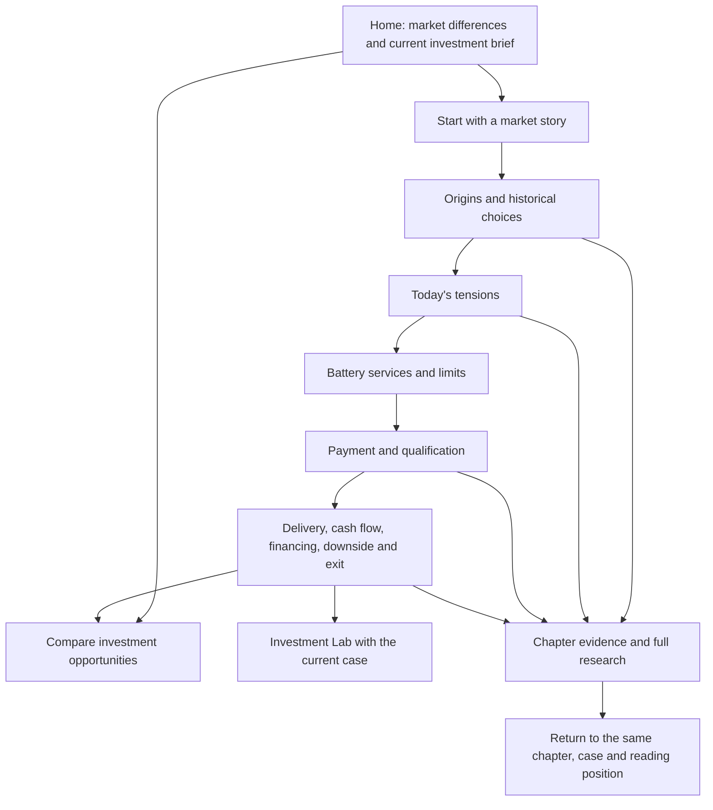

# Experience and Page Design Preparation

Pack: BESS-IX-2026-10-30, version 1.0  
Status: proposed information architecture and annotated layout brief; no website/UI implementation  
Navigation: [Master plan](README.md) | [WA storyboard](western-australia-storyboard.md) | [Content contract](evidence-and-content-specification.md#5-proposed-story-content-contract) | [Engineering work](engineering-work-packages.md)

## 1. Two entry paths, one investment context

Offer **Start with the grid story** and **Compare investment opportunities** as equal first actions. A reader's electricity familiarity is a reading preference. The existing investor perspectives are a separate choice: infrastructure fund, strategic investor, new market entrant and developer. Do not infer one from the other.



This is a navigation proposal. The actual current paths include `/`, `/returns`, `/investment-lab`, `/markets/:slug`, research tab/section paths, `/data`, `/changes`, `/news`, `/scout` and `/desk`. Do not invent an already-existing `/compare` page. New story navigation should extend the current market resource rather than creating a second incompatible market registry.

## 2. Page inventory and reuse

| Surface | Current foundation | Planned change / output | Priority and next action |
| --- | --- | --- | --- |
| Home | Existing investment brief, opportunities and SVG globe | Two entry actions, one clear market distinction, three contrasting story invitations, retained current investment brief | Pilot entry P0; richer global scene P1 |
| Global opportunities (`/returns`) | Existing comparison/result view | Keep direct comparison; add optional tension/payment lenses and links to story chapters | Preserve during pilot; narrative comparison P1 |
| Market overview | Existing no-tab market experience | Six-chapter story mode plus immediate investment summary; retain current-case context and deep research links | P0 for WA |
| Shared asset explanation | Existing explanations and investment facts | Embedded station cutaway, power/energy lesson, performance/rights and cost-category links | P0, diagram before 3D |
| Investment Lab | Existing cross-market underwriting workspace and saved cases | Explicit, validated current-case handoff and a return path to the originating shot | P0 integration; do not replace the model |
| Full market research | Existing tab/section routes and research dialog | Chapter-specific evidence entry, source dates/status, return to origin and preserved focus | P0 |
| Public data/status | Existing `/data` and provenance envelope | Link relevant series and stale/unavailable state from evidence; retain existing governance meaning | P0 links; no new ETL authority |
| Story comparison | Existing numerical comparison remains primary | Later side-by-side history, tension, payer and weakening-value cards for 2-3 markets | P1 after pilot reuse |
| News/changes/scout/desk | Existing independent routes | Remain accessible; no unrelated redesign | Preserve |

Do not add a mandatory onboarding questionnaire, a new account system, a new CMS or an unrelated global navigation redesign. The new reading mode must remain useful when the reader never opens a 3D scene.

## 3. Layout and hierarchy

### Desktop story layout

Use a calm editorial page with approximately 40% narrative and 60% scene/evidence area where width permits. A narrow reading column carries the question and meaning; a stable visual stage carries one main change. The scene may be sticky within its chapter, but must not trap scroll or require a long scroll animation to unlock text.

```text
GLOBAL BESS     Markets     Investment comparison     Research     Language

Western Australia / WEM-SWIS       Current case       Investor perspective
Story | Investment summary        Case basis and evidence status

03 / Today's tensions             [Scene or equivalent diagram]
Why can a sunny noon be difficult? [Fixed labels, legend and scope]
One short answer.                 [One primary control]

What changes / What remains        [2D evidence with units and dates]
Investment meaning                [Evidence detail opens on request]
Interpretation boundary

Previous   Next   Chapter list   Pause   Use diagrams   Investment summary
```

The current-case bar must not dominate the story with jargon. Show a readable summary; expand to disclose route, duration, scale, entry stage, currency and data/model basis. Case changes and teaching changes have different control labels.

### Mobile story layout

Use “one visual, one explanation, one control” in a normal vertical flow. A visual occupies roughly half a screen rather than the entire viewport. The default camera and diagram must answer the question without rotating the scene. Controls remain visible without covering captions.

```text
Market / Chapter              Case summary
Question
[Poster / diagram / optional scene]
Scope, legend and teaching/data label
[One large primary control]
Short answer
Investment meaning
Evidence / Full research
Previous    Chapters    Next
Investment summary / Continue in Investment Lab
```

Tables use grouped rows, labelled cards or a readable chart/table alternative. If horizontal scrolling is necessary for a financial table, label it, preserve row identity and keep a text summary. Scene labels should not require pinching or two-finger gestures. Avoid nested scroll panels on a small screen.

### Home concept

The home opening should make market differences tangible before presenting unfamiliar acronyms. Proposed copy: **See how electricity systems change. Understand what gives a battery investment value.** The world view remains paired with a keyboard-accessible market list. Story invitations can group questions as **Wrong time**, **Wrong place**, and **Need for response**; these are explanatory lenses rather than exhaustive or mutually exclusive market classifications.

Every invitation also shows a market name, one local distinction, and a direct investment route. Do not replace current investment conclusions with unsourced promotional claims or imply that a story priority is an investment recommendation.

## 4. Visual system

Reuse and extend the existing [design tokens](../../src/styles/tokens.css) rather than applying a global density reset. Preserve the current research tables while making story prose easier for newcomers.

| Element | Preparation requirement |
| --- | --- |
| Surface and palette | Off-white research pages; deep-green scene stage; restrained natural asset colors. Any new hexadecimal palette is provisional until contrast and existing-theme checks pass. |
| Typography | System fonts where practical; editorial headings; proposed story body 16-18 px desktop and at least 16 px mobile. Keep tabular figures in comparisons and currency charts. |
| Scale and density | Default shot has one question, one principal change, one investment meaning and one boundary. Put detailed method and tables behind evidence controls. |
| Geometry | Simplified low-polygon terrain and recognizable generator, rooftop, wind, load and battery objects; generic asset geometry clearly labelled. |
| Semantic colors | Stable meanings for generation, load, storage and constraint. Keep these separate from existing market series and risk/status ramps. Add shape, pattern and text labels. |
| Geography and precision | Preserve real region context; distinguish approximate topology from verified coordinates. Dashed future assets and scenario backgrounds differ from observed assets. |
| SOC | Show label and numeric value as well as fill; use accessible DOM text outside the canvas. No deceptive volume metaphor for financial return. |
| Financial graphics | Flat bars, lines, waterfalls and tables with units and baselines. Avoid 3D IRR columns, perspective ranking or station size as return encoding. |
| Motion | Short user-controlled transitions, pause and instant mode; no continual rotation, particle spectacle, long intro or scroll hijacking. Reduced-motion settings select the static/instant path. |
| Lighting and materials | Soft shadows and controlled day/night emphasis; mobile quality avoids expensive real-time effects. Do not hide essential labels in darkness or depth blur. |
| Audio | Silent first release. Optional later narration needs captions/transcript, language review, controls and asset rights. |
| Theme compatibility | Preserve existing theme preference. Test scenes, captions, diagrams, warnings and finance charts in supported themes. |

Proposed interaction targets include at least 44 by 44 CSS-pixel primary touch areas, visible focus, sufficient text contrast, and no meaning conveyed by color alone. Verify these in actual designs rather than claiming that the palette itself meets accessibility requirements. Performance budgets are owned by [the engineering plan](engineering-work-packages.md#5-asset-and-performance-budgets).

## 5. Component preparation inventory

| Component | Required behavior | Input / output | First use |
| --- | --- | --- | --- |
| Story entry card | One market distinction, reading time, evidence status and investment shortcut | Registry/content references -> market/chapter navigation | Home, market overview |
| Story shell | Question, text, visual/fallback, investment meaning and chapter navigation | Story contract + state -> accessible page | All WA shots |
| Chapter navigator | Direct jump, current position, previous/next, keyboard and browser history | Stable chapter/shot IDs -> restored position | All chapters |
| Current-case bar | Expand basis; distinguish case inputs from teaching presets; visible changed/unavailable state | Existing case adapter -> read-only summary or explicit change action | Story and Lab |
| Historical node card | Constraint/choice/inheritance/consequence, dates and fact/scenario type | Reviewed nodes -> selected layer and evidence | wa-03 |
| Grid visual host | Own scene lifecycle with poster/diagram always available | Scene key + teaching state -> one bounded active scene | wa-01 to 08 |
| Day/night diagram | Power versus energy, chosen period, units and teaching/observed status | Approved trace or qualitative preset -> synchronized view | wa-05/06/08 |
| Asset cutaway and hotspot list | Equipment function, cost category, performance/rights and missing-data status | Shared asset + content references -> selected explanation | wa-09 |
| Payment path | Payer, unit, eligibility, obligations, settlement, term and evidence | Route-specific approved content -> one readable path | wa-10 |
| Commitment/compatibility explanation | Separate teaching conflict from project pass/unknown/fail | Teaching presets or existing constraint result -> labelled disposition | wa-11 |
| Delivery-to-receipt timeline | Separate capital, physical delivery, qualification and receipts | Existing timing outputs + project evidence -> labelled milestones | wa-12 |
| Cash-flow and downside panel | Same case identity and dated financial outputs across views | WP-05 result adapter -> auditable 2D charts/table | wa-13 |
| Evidence drawer / research return | Source/date/method/limits; link deeper research; return focus and reading state | Claim/source/shot reference -> drawer and origin token | Every chapter |
| Plain-language explanation | Short meaning, boundary, optional professional term and source | Shared reviewed glossary -> consistent teaching text | Throughout |
| Mode/status control | Pause, use diagrams, retry, unavailable data; preserve current case | Capability/preference/error -> equivalent content | All visual states |

Inputs above are responsibilities for later code design, not existing universal APIs. Keep the public editorial content independent of the renderer so both diagrams and 3D consume the same approved meaning.

## 6. Shared explanations and investment language

Prepare a small glossary once and apply it consistently across markets. Introduce the plain-language idea before the acronym, then allow professional detail on demand.

| Term group | Plain-language explanation to prepare | Boundary that must accompany it |
| --- | --- | --- |
| MW, MWh, duration, SOC | Delivery rate, stored energy, nominal hours and remaining usable energy | Nameplate energy differs from deliverable energy after limits and losses |
| Operational demand, net load | What remains for the defined grid resources after specified embedded generation | Definitions vary by dataset; not all sources subtract the same components |
| Energy shifting | Absorb energy at one time and return less later | Timing value depends on prices, charging rights, costs and restrictions |
| Response/reserve/system service | Be ready to change output/consumption under specified requirements | Product purpose, direction, activation and sustained delivery differ |
| Capacity/availability payment | Payment for a qualified ability or contractual commitment | Not unlimited revenue or a guarantee of debt service |
| Qualification/accreditation | Demonstrating the right capability and meeting participation requirements | Capability, application, approval, award and ongoing compliance are distinct |
| RTB, construction, energization, COD | Different development/delivery milestones | Commercial operation does not start every payment simultaneously |
| Fixed/contracted, renewal, merchant | Different revenue exposures and durations | A model assumption is not verified signed coverage; expiry creates a tail |
| Grant/support | Capital support and its conditions/timing | Award is not receipt; grant is not recurring operating income |
| Gross, operating, equity cash flow | Successive steps from service income to investor receipts | Costs, reinvestment, tax and debt treatment follow the selected model |
| All-equity and levered IRR | Returns before and after a defined financing structure | Cash-flow clock, entry price, maturity funding and exit assumptions matter |
| Downside, DSCR, exit | Stress case, debt-service coverage and sale/terminal exposure | Neither a probability forecast nor a lender commitment or guaranteed sale |

Avoid generic labels such as “secured” without disclosing the evidence and period. When the model exposes only an aggregated trading/ancillary amount, show that aggregation and its limitation rather than inventing a detailed revenue split.

## 7. Bilingual website requirements

This pack's text, headings, tables, templates and filenames remain English. The implementation requires complete English and Simplified Chinese coverage for navigation, chapter copy, controls, accessibility labels, captions, evidence/method notes, units, error states, exports and contract-status descriptions.

Use stable IDs and reviewed locale entries rather than embedding translations in geometry or textures. Source titles may retain their original language with an explanatory translation. An untranslated legal ambiguity stays flagged. Do not shorten the Chinese meaning of an eligibility or contractual caveat merely to make a label fit.

Language switching must preserve market, chapter, shot, investor, case, teaching preset, evidence origin and reading position as far as layout permits. Restore focus to the same semantic control. Localize dates and number formatting while retaining exact currency/unit semantics and stored financial values. Test long labels, multi-line buttons, mobile tables, diagram annotations and screen-reader order in both languages.

Record translation status separately from English research approval: English approved / Chinese pending cannot pass bilingual release. Use two meaning reviews: technical/service meaning and investment/payment meaning. No machine-generated translation should silently become an approved contract summary.

## 8. Loading, failure, evidence and return states

| State | User-facing behavior | Preserved context |
| --- | --- | --- |
| Scene not requested | Poster/diagram and complete text available; optional “Explore the scene” action | Chapter and case |
| Scene loading | Visible progress/status and immediate diagram path; no blank stage | Existing reading and controls |
| Unsupported graphics or asset failure | “Use diagrams” with the same question, explanation, evidence and investment route; optional retry | Chapter, case, teaching selection where meaningful |
| Reduced motion | Instant transitions/static diagrams and explicit manual controls | Same learning path |
| Background or offscreen | Pause rendering; resume the selected state when relevant | No chapter advance |
| Data stale/missing | Date and usable last vintage or an unavailable message; retain qualitative explanation | No substituted financial demonstration number |
| Evidence opened | Focus moves into a labelled panel; clear source scope, dates and method; ordinary research links work | Originating shot, scroll anchor and case |
| Evidence closed / research returned | Focus returns to trigger; restore semantic position | No reset to chapter one |
| Case incompatible with new market | Explain which field cannot transfer; use an explicit compatible selection or show unavailable state | Preserve old case for Back; do not silently remap rights |

Keep implementation terms, exception traces and device diagnostics out of these flows. Technical evidence belongs in test records; user-facing copy explains available actions and interpretation limits.

## 9. Design preparation deliverables

Before polished asset production, prepare annotated home, market opening, historical timeline, day/night, cutaway, payer/qualification, and cash-flow/delivery views. Each needs desktop/mobile variants and a diagram-only equivalent. Include loading/failure, stale data, incompatible case and reduced-motion variants for the relevant components.

Every shot annotation must use the [WA shot-sheet fields](western-australia-storyboard.md), including investment meaning and misreading boundary. Mark whether it is a sketch, annotated wireframe, high-fidelity static design or implemented screenshot; do not label a text wireframe a completed high-fidelity design. Review hierarchy and understanding before spending time on materials and lighting.

Required layout widths, user tasks and screenshot evidence are defined once in [the acceptance plan](preparation-migration-and-acceptance.md#5-understanding-tests-with-non-sector-investors). Assets and performance measurements are governed by the engineering plan, so changing a scene budget does not require editing every shot sheet.
