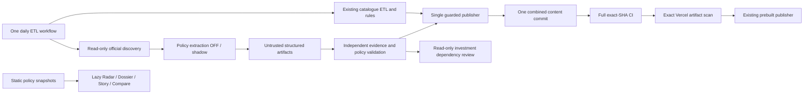

# P1-D architecture

Baseline `494ce7b`, static Vite/native ES modules/D3, 18 allocation markets. No backend, database, account or framework. Design checkpoint D0; implementation acceptance is recorded separately.

| As-is path | To-be contract / non-regression |
|---|---|
| `src/app/router.js`, `src/app/app.js` | Lazy `/policy`, dossiers, stories, compare and market-policy adapter; stale navigation invalidated |
| `src/markets/registry.js` | Sole investment market identity; global discovery jurisdictions remain separate |
| `src/news/newsFeed.js`, `src/governance/newsTags.js` | Headlines are leads only; untouched legal/territorial authority |
| `src/experience/story/`, market `storyPack.js` | Signed investment stories unchanged; policy story uses its own evidence graph |
| `src/markets/tabGroups.js`, `marketPage.js` | Seven groups unchanged; policy route intercepted by shell, no duplicated market sections |
| GB `sections/registry.js`, NEM `sections/registry.js` | Dynamic section imports preserved; no eager policy dependency |
| WA `dashboard.js` | Hand-rendered sections untouched; same shared policy adapter |
| `etl/run.mjs`, `src/governance/datasets.js` | All connectors including industry news retained |
| `etl/rules.mjs`, `etl/lib/viewWriter.mjs` | Existing fresh-data rules retain authority; policy cannot invoke or impersonate them |
| `.github/workflows/etl.yml` | Replace ordinary six-hour cron with one 06:17 UTC cycle, preserve monthly/weekly/manual events |
| `.github/workflows/ci.yml`, `scripts/publish-production.mjs` | Full CI and exact-artifact scan → prebuilt release unchanged |

Proposed policy boundary: `public/data/public/policy/`, immutable content-addressed versions plus an atomically replaced index pointer. Public data contains metadata and concise independently written analysis, never full restricted documents or shadow drafts. Source bodies and reviewer packets stay in ignored operational output. A policy writer has a narrower boundary than the existing market writer; neither boundary widens the other's rights.

Daily stages: read-only official discovery; optional isolated model that has no write token and no tools; independent validator; refresh/publisher which runs all existing market fetches and approved rules and aggregates validated policy artifacts. Failure to extract policy retains last-known-good policy and cannot discard valid market data. A failed source retains its existing dataset. One content commit and one explicit reusable CI call. Compare parent SHA before push; concurrent main changes reject rather than overwrite. Rerun unchanged content is a no-op. One workflow concurrency group serializes cycles; calendar cycle IDs plus content hashes identify retries. Daily collection is a target, not a clock guarantee.

Desktop wireframe: filter bar → world map | event feed → evidence preview → dossier/story. Mobile: map/feed switch, same accessible list and filters. Dossier: instrument → dates → lifecycle → evidence → version diff. Story: 30-second answer → guided scenes → Explorer and evidence. Compare: topic rows × four distinct jurisdictions, with compatibility labels and source links. URL query stores filters, selection and reading position; browser history restores them. Unknown/unmonitored regions have an explicit coverage state.

Baseline measurement must precede UI changes: build budget, homepage and GB/NEM route bytes, DOM/SVG node count, CLS and long tasks on this host. P1-A/B/C historical measurements are context, not measurements of this branch. New policy code must remain outside unrelated route graphs. No baseline fixture regeneration.
