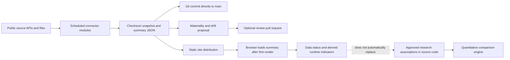
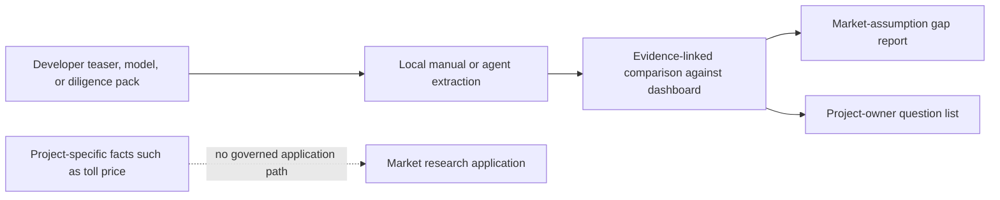
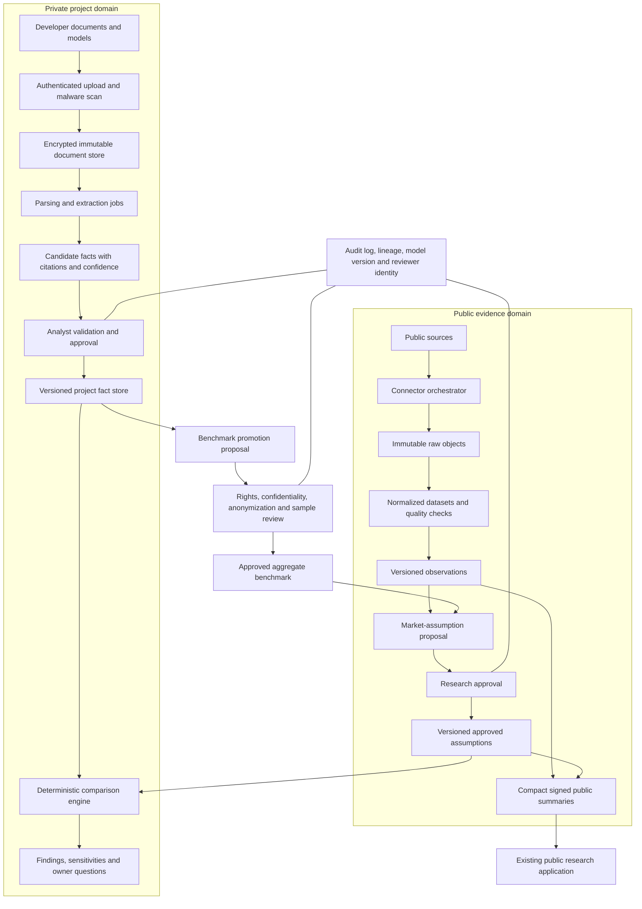

# BESS Research Platform — Repository Audit and Improvement Plan

**Audit date:** 9 August 2026  
**Repository snapshot:** `c46d46a` on `main`  
**Audit mode:** Read-only inspection of the application, data, tests, build, deployment configuration, and project-comparison workflow. This document is the only intended repository addition.  
**Audience:** Product owner, investment team, data engineering, quantitative research, application engineering, and security/operations.

## 1. Executive conclusion

The repository contains a strong research prototype with several unusually good foundations:

- a centralized market registry and consistent market-module contract;
- a deterministic, mostly pure quantitative comparison engine;
- explicit evidence and authority classes that distinguish observed data, research anchors, and approved assumptions;
- checksum-based public-data snapshots, provenance, source attribution, and material-drift proposals;
- a production-build exclusion mechanism for local confidential data;
- broad structural and quantitative unit-test coverage;
- a careful canonical project schema for several emerging storage-project connectors; and
- a well-designed, but currently manual, project-comparison method under `deliverables/_comparison_system`.

The present system is nevertheless still a **static public research application**, not yet a secure project diligence platform. It has no private upload service, authentication, project database, document store, analyst approval workflow, or safe route for converting confidential project facts into governed benchmarks. Developer teasers and financial models therefore cannot be ingested into the live application without crossing an unacceptable security and governance boundary.

Four issues should be treated as immediate blockers before feature expansion:

1. Confidential project inputs and generated deliverables do not yet have a controlled repository boundary. `deliverables/` was untracked but not ignored at the audit snapshot, and repository documentation acknowledges earlier confidential material in Git history.
2. The current CI quality gate is not reliable: the production-bundle confidentiality test runs before the production build, the public-data verifier fails on the news dataset, and the economics-chain test references implementation files that do not exist.
3. Consistent public-data operation is not yet achieved. Present market-specific summaries cover only 4 of 14 allocation markets, while the direct automated influence mapping covers only 5 unique assumption paths out of 90 authority-classified paths.
4. The newer canonical project-source pipeline is only partially connected: several robust connector modules exist, but there is no working `etl:projects` command or scheduled orchestrator, and the application does not use the central project registry.

The recommended direction is not a wholesale rewrite. Preserve the public research UI, quantitative engine, market registry, and governance concepts. Add a separate private project-workbench boundary and strengthen the ingestion and publication layers around the existing core.

## 2. Scope and validation performed

The audit covered:

- all tracked and visible untracked repository areas relevant to application behavior;
- client routes, market modules, rendering, state, localization, and map behavior;
- quantitative comparison, debt, revenue-stack, scenario, decision, and portfolio-stress logic;
- public-data connectors, catalogues, schemas, snapshot publication, drift proposals, and runtime loading;
- storage-project connectors, canonical schemas, reconciliation, provenance, and map integration;
- local confidential-data substitution and bundle-exclusion controls;
- project-comparison instructions and current deliverable workflow;
- Node dependencies and vulnerability status;
- unit, structural, governance, and confidentiality tests;
- Vite production build output and bundle composition;
- GitHub Actions, Cloudflare Pages configuration, and generated-data commit behavior; and
- documentation consistency.

Validation results at the audited snapshot:

| Check | Result | Interpretation |
|---|---:|---|
| Production build | Pass | Application is buildable. |
| Production JavaScript | 3,370.85 kB minified / 1,441.19 kB gzip | Far above Vite's 500 kB warning threshold; route-level splitting is absent. |
| Production CSS | 54.90 kB | Not a material concern. |
| Test run without process isolation | 401 pass, 1 fail | Genuine failure is a missing economics-chain implementation module. The default isolated runner also encountered a sandbox-specific process-spawn restriction during this audit. |
| Public-data verification | Fail | `industry-news.json` is treated as an orphan because its custom format is outside the dataset catalogue/envelope contract. |
| Dependency vulnerability audit | 0 known vulnerabilities | Good current dependency hygiene; continue automated monitoring. |
| Fresh production-bundle confidential-marker scan | Pass | The Vite substitution mechanism excluded the known local confidential markers in the audited build. CI does not currently run this scan at the correct time. |
| Working tree before this report | `deliverables/` untracked | Material accidental-commit risk; no application code was changed by this audit. |

## 3. Current system architecture

### 3.1 Runtime and deployment

The user-facing application is a Vite 5 vanilla-JavaScript single-page application. It is deployed as static assets to Cloudflare Pages with a catch-all `_redirects` rule. There is no server-side runtime, API, user identity, database, job system, or private storage service in this repository.

The principal routes are:

- `/` — market allocation and comparison;
- `/investment-lab` — governed market-level override and sensitivity work;
- `/data` — public feed and source status;
- `/news` — industry news aggregation; and
- `/markets/:slug/:tab` — individual market dashboards and tools.

All market allocation modules are statically imported. There are 14 allocation markets and 12 detail-dashboard implementations; the three Japanese allocation entries share one dashboard implementation.

### 3.2 Main functional domains

| Domain | Current implementation | Maturity |
|---|---|---|
| Market research UI | Static SPA, bilingual content, market dashboards, maps, data status and news | Functional prototype |
| Portfolio allocation | Central registry, normalized 15-year USD cash-flow comparison, IRR/MOIC/NPV | Strong deterministic core, still seed-heavy |
| Investment Lab | Governed ranges, revenue strategies, leverage, decision and stress overlays | Useful research tool, not a project underwriting system |
| Public-source ingestion | ECB, ENTSO-E, JEPX and AEMO-WEM connectors plus custom news ingestion | Partially operational |
| Project-source ingestion | EIA-860M, MaStR, AEMO project information and OSM modules with canonical schema | Good components, incomplete orchestration and runtime integration |
| Confidential local data | Ignored local files plus Vite development substitution and production stubs | Safe for one developer's local prototype; unsuitable for collaboration or live intake |
| Project diligence | Agent-driven extraction and comparison producing Markdown and Word deliverables | Strong manual workflow, outside the application |
| Deployment | GitHub Actions and Cloudflare Pages static hosting | Simple, but quality/deploy gates need repair |

### 3.3 Current end-to-end public-data flow

This separation between observed data and approved assumptions is correct. Its practical reach is limited by feed coverage, missing summaries, inconsistent freshness semantics, and the use of Git as the high-frequency data publication bus.

### 3.4 Current project-material flow

Today, the actual project workflow is manual and external to the application:

The comparison instructions enforce sensible sourcing, red/amber/green findings, materiality, owner questions, and document references. The missing part is a durable application data model and a secure workflow around those instructions.

## 4. What is working well

### 4.1 Governance and evidence separation

The `src/governance` modules make evidence status explicit. Public observations do not silently overwrite investment assumptions, and material drift can produce a proposal rather than an automatic merge. This is the right control model for an investment research system.

The comparison authority registry classifies 90 paths, providing a useful base for field-level lineage, review responsibility, and change control.

### 4.2 Quantitative architecture

The comparison engine is composed largely of pure functions and is extensively tested. It normalizes markets to a common 15-year USD view and supports multiple revenue strategies, project debt, exit assumptions, cash flows, IRR, MOIC, and NPV. The Investment Lab adds governed overrides instead of allowing arbitrary mutation of base assumptions.

The decision-refinement modules correctly separate evidence quality, pipeline eligibility, revenue-stack feasibility, scenario outcomes, portfolio stress, and capex-completeness warnings. This is a solid foundation for a future project comparison engine.

### 4.3 Public-data engineering controls

The shared fetch layer provides timeouts, retries, and exponential backoff. Snapshot publication uses content checksums, retains previous files, applies atomic-write patterns in newer project connectors, and includes source attribution and licence fields. Connector failure generally retains the last successful snapshot, which is a sound availability policy when paired with alerts.

### 4.4 Confidential bundle exclusion

The Vite local-data plugin resolves confidential local modules to production stubs and disables production source maps. A fresh audited build did not contain the known confidential markers. The mechanism itself is effective; the CI sequencing around it is not.

### 4.5 Canonical project connector design

The newer storage-project modules use a thoughtful canonical schema: project stage, nullable duration, provenance, source identifiers, reconciliation, and explicit avoidance of guessed coordinates. They distinguish table records from map-eligible records and avoid treating speculative queue entries as operating projects. These conventions should become the shared contract for all project ingestion.

## 5. Detailed findings and priorities

Priority definitions:

- **P0 — blocker:** address before accepting live confidential project material or relying on automated deployment.
- **P1 — foundation:** required for a dependable data and project-diligence product.
- **P2 — scale and maintainability:** improves cost, performance, research quality, and developer velocity after the foundations are safe.

### P0-01 — Confidential project material has no controlled repository boundary

**Evidence**

- `deliverables/` was untracked but not covered by `.gitignore` at the audited snapshot.
- The comparison workflow produces project-specific reports and Word question lists under that directory.
- `local-data/` is ignored and excluded from production, but it is plaintext local storage without access control, encryption, audit logging, retention policy, or shared-team semantics.
- Repository documentation records that earlier confidential Western Australia detail remains in Git history.

**Impact**

An analyst can accidentally stage project outputs or source-derived information. Anyone with a clone may have access to historical confidential material. The local-data convention protects the public bundle but is not a security system.

**Recommendation**

1. Immediately ignore project-specific inputs, extracted files, and outputs by default. Move reusable comparison code and templates to a separately tracked, clearly non-confidential directory.
2. Inventory repository history for confidential artifacts and decide whether repository access restriction is sufficient or a history purge is required.
3. Define retention, deletion, export, and access rules before accepting live developer materials.
4. Use encrypted private object storage and a project metadata database for the future application; never place uploaded documents under `public/`, `src/`, or Git-managed data folders.

**Acceptance test:** A newly uploaded or locally processed project cannot appear in `git status`, the production bundle, public static assets, logs, or analytics payloads.

### P0-02 — CI controls currently give a false sense of safety

**Evidence**

- In `.github/workflows/ci.yml`, tests run before `npm run build`.
- `tests/bundle-confidentiality.test.js` scans `dist/` and skips when it is absent. Because `dist/` is ignored, a fresh CI checkout normally has no build to scan. The new bundle is produced only after the test has finished.
- `npm run etl:verify` currently fails because `public/data/public/industry-news.json` uses a custom schema and has no dataset-catalogue entry.
- `tests/economics-chain.test.js` imports `src/economics/requirement.js`, `chain.js`, and `chainBlocks.js`, which do not exist.

**Impact**

The most important confidentiality assertion is not enforced against the artifact being deployed. CI is also red or unreliable for unrelated structural inconsistencies, making genuine regressions easier to ignore.

**Recommendation**

1. Build first, then run the bundle-confidentiality test against the newly generated artifact.
2. Give news either a first-class dataset envelope/catalogue entry or a separate explicit verifier; do not leave it as an undeclared exception in the governed directory.
3. Decide whether economics-chain is an intended feature. Restore the missing implementation or remove the orphan test and related contract references in one reviewed change.
4. Make all checks required on `main` and ensure Cloudflare production deploys only a commit that has passed them.
5. Add a minimal production smoke test that serves `dist/`, opens each top-level route, and verifies no runtime console errors.

**Acceptance test:** A clean checkout can run install, build, all tests, bundle scan, public-data verification, and route smoke tests with zero skipped security gates and zero failures.

### P0-03 — The current static architecture cannot safely accept developer teasers or models

**Evidence**

There is no authenticated API, upload endpoint, user or project identity, object store, database, parser job, review queue, audit trail, or project workspace. The current comparison method runs as an external agent workflow and writes file deliverables.

**Impact**

Adding a browser file input to the existing SPA would not solve the requirement. It would create uncontrolled handling of confidential documents, weak provenance, no durable approval state, and no safe multi-user access model.

**Recommendation**

Add a separate private project-workbench service while retaining the current public site. The minimum boundary requires:

- authentication and role-based project access;
- encrypted, private object storage with malware scanning and immutable hashes;
- a relational store for project facts, citations, findings, approvals, and audit events;
- asynchronous parsing/extraction jobs for PDF, DOCX, XLSX and CSV;
- deterministic validation and unit normalization;
- analyst review before any extracted fact becomes approved; and
- complete deletion and export paths.

**Acceptance test:** Every project fact can be traced to a document version, page/sheet/cell or other source locator, extraction run, reviewer, approval time, and calculation version.

### P0-04 — Public-data consistency and market coverage do not meet the stated requirement

**Evidence**

- The market registry contains 14 allocation markets.
- At the snapshot, market-specific summary artifacts were present for Western Australia and the three Japanese areas: 4 of 14 markets.
- Four ENTSO-E feeds are catalogued but their summary artifacts are absent.
- NEM, Germany, Italy, PJM, ERCOT, and CAISO do not have equivalent market-level catalogue feeds in the current scheduled public-data layer.
- The authority registry classifies 90 comparison paths, while dataset `bearsOn` declarations directly map automated data to only 5 unique paths: four FX paths and merchant gross economics.

**Impact**

The data-status feature can show successful feeds, but the overall product cannot yet claim consistently refreshed, comparable public evidence across the full market universe. A green status on a small subset may be mistaken for system-wide freshness.

**Recommendation**

1. Define a market-by-metric coverage matrix with required source, cadence, licence, maximum age, transformation, and fallback owner.
2. Assign each market a readiness level: seed only, observed overlay, calibrated, or investment-grade.
3. Complete or deliberately disable configured feeds that cannot operate in production; never show an absent feed as implicitly covered.
4. Prioritize data that materially changes underwriting: revenue prices, ancillary/capacity mechanisms, capex, duration, connection, tax, FX and financing.
5. Publish explicit coverage and staleness indicators in both the registry and UI.

**Acceptance test:** Every displayed market and every material metric has a visible evidence class, source status, observation-through date, owner, and documented fallback.

### P1-01 — Canonical project-source components are not an operating pipeline

**Evidence**

- Connector modules exist for EIA-860M, MaStR, AEMO project information, enrichment, and OSM storage data.
- `src/projects/sources.js` references `npm run etl:projects`, but `package.json` has no such script.
- There is no project-source orchestrator in the scheduled workflow.
- The browser application does not import the central project registry; Ireland and some other maps use direct market-specific files instead.
- Only Ireland is registered in the central project-source module, while several source declarations elsewhere are not backed by scheduled canonical artifacts.

**Impact**

Good ingestion code is effectively dormant or fragmented. Market maps can diverge in definitions, provenance, refresh cadence, and status reporting.

**Recommendation**

Create one project-source manifest and orchestrator that drives connectors, canonical validation, reconciliation, atomic publication, health status, and scheduled refresh. Make market maps consume the central registry rather than importing source-specific files. Separate project inventories, development queues, and generation assets as distinct dataset types.

### P1-02 — Freshness metadata conflates “checked” with “observed”

**Evidence**

Summary files can receive a new `fetchedAt` on a successful check even when the underlying observation and full snapshot are unchanged. Runtime freshness uses that summary timestamp, while the actual source observation date can be older.

**Impact**

The UI may describe an old observation as newly refreshed. For power markets, source publication delay and observation coverage are materially different from connector availability.

**Recommendation**

Use separate fields:

- `checkedAt` — last connector attempt;
- `succeededAt` — last successful retrieval;
- `sourcePublishedAt` — source release timestamp when available;
- `observedThrough` — latest market period represented;
- `normalizedAt` — last transformation; and
- `approvedAt` — governance approval time where relevant.

Derive status from a dataset-specific freshness policy, not one universal timestamp.

### P1-03 — Git and `main` are being used as a high-frequency data bus

**Evidence**

The scheduled ETL runs every six hours and commits generated public data directly to `main`. Nineteen data-bot commits were visible in roughly five days of recent history. The workflow retains availability on source failure but does not have a rebase/retry strategy for concurrent user pushes.

**Impact**

Generated data creates repository churn, can race development work, and may trigger deployments even when later governance checks fail. Historical full snapshots will scale poorly in Git.

**Recommendation**

Publish immutable raw and normalized artifacts to versioned object storage. Commit only compact approved manifests or periodic release snapshots to the application repository. If Git publication remains temporarily, use a dedicated data branch, required checks, retry-safe updates, and a controlled promotion step to production.

### P1-04 — The production application ships a monolithic bundle and unnecessary public artifacts

**Evidence**

- All market modules are statically imported by the registry.
- The audited main JavaScript bundle is 3.37 MB minified and 1.44 MB gzip.
- Full public audit datasets are copied into `dist/` even though the browser primarily loads summaries.
- Complex map and market modules contain large amounts of content and behavior in single files.

**Impact**

Every visitor pays for markets and tools they do not open. Startup, parse, and mobile performance will worsen as markets and project datasets grow. Static-host bandwidth also includes full audit artifacts that are not required for the primary UI.

**Recommendation**

Lazy-load route and market modules, split large map components, move bulky narrative/reference content to asynchronously loaded data files, and host full audit artifacts separately from the application distribution. Establish bundle budgets per route and fail CI on material regression.

### P1-05 — Project facts and market assumptions need different governance domains

**Problem**

A project tolling price can be valuable to the research platform, but it is not automatically a market assumption. It may be confidential, project-specific, gross or net, indexed or nominal, conditional, duration-specific, and non-transferable.

**Recommendation**

Maintain four distinct domains:

1. **Public observations** — source data with licence and observation lineage.
2. **Governed market assumptions** — approved research inputs used by the quantitative engine.
3. **Confidential project facts** — developer assertions and model-derived values, visible only inside the authorized project workspace.
4. **Approved benchmark evidence** — anonymized or aggregated facts promoted only after rights, confidentiality, comparability, and minimum-sample review.

No project fact should directly mutate a market assumption. Promotion must be an explicit proposal with a reviewer and audit trail.

### P1-06 — Operational failures are retained but not actively managed

**Evidence**

Connector failures generally preserve the previous snapshot and exit successfully. Browser fetch failures often degrade silently. There is no central error tracking, feed failure alert, consecutive-failure policy, or service-level objective.

**Impact**

Availability is preserved, but a feed can remain stale for a long time without creating an actionable incident.

**Recommendation**

Add dataset health records and alerts for consecutive failures, excessive observation age, schema drift, row-count anomalies, checksum anomalies, and publication failures. Show the same health state in the analyst UI. Add client error monitoring only after a privacy review.

### P1-07 — Quantitative outputs need stronger definition, calibration, and project adapters

**Strengths**

The current engine is transparent, deterministic, testable, and appropriately separates strategies and leverage.

**Limitations**

- Market comparisons remain heavily dependent on seed and research-anchor inputs.
- Common 15-year cash flows improve comparability but can obscure jurisdiction-specific contract lengths, augmentation profiles, taxes, degradation, dispatch constraints, network charges, working capital, and terminal value definitions.
- Merchant and ancillary outcomes are simplified indices rather than calibrated dispatch simulations for every market.
- Debt is a useful two-tranche abstraction, not a full covenant, reserve, sculpting, or downside-default model.
- Project-specific definitions are not normalized before comparison.
- Scenario relationships and correlations are limited; backtesting and forecast-error reporting are not systematic.

**Recommendation**

Introduce versioned calculation and assumption sets, a formal cash-flow line-item schema, unit/basis definitions, project-to-market adapters, calibration reports, and deterministic reconciliation tests. Add probabilistic analysis only after driver distributions and correlations are evidence-backed. Keep every headline output reproducible from an immutable input version.

### P1-08 — Future project input creates a new browser-security boundary

**Evidence**

The DOM helper supports `innerHTML`, and components use HTML insertion for trusted static or calculated content. This is not currently evidence of an exploitable public issue, but uploaded developer text would be untrusted.

**Recommendation**

Render project strings with text nodes by default, enforce server-side schemas and size limits, sanitize only the small subset of fields that genuinely require rich text, and add content-security headers. Review the necessity and privacy implications of Vercel Analytics on a Cloudflare-hosted research application. Add `_headers` with CSP, frame, MIME, referrer, and permissions policies.

### P2-01 — Documentation is materially out of date

Examples include stale market and route counts, old test totals, old bundle sizes, obsolete dependency descriptions, contradictory statements about whether local-data substitution exists, an incorrect source-map statement, and a reference to the nonexistent `etl:projects` command.

Generate inventory sections from the registry and package metadata where practical. Add small documentation assertions for commands, route counts, and data contracts. Treat architecture decision records as current decisions, while moving historical incident notes to an archive.

### P2-02 — Test coverage is broad but too concentrated in Node structural tests

There is no browser end-to-end suite, visual regression coverage, accessibility test, mobile interaction test, performance budget, linting, formatting gate, or static type analysis. Complex SVG maps and full-page rerenders are especially difficult to validate structurally.

Add a small Playwright suite for top routes, market navigation, keyboard access, map selection, data failure states, and project-workbench permissions. Add accessibility scanning and per-route bundle budgets. Introduce JSDoc plus TypeScript checking incrementally before considering a full language migration.

### P2-03 — Connector and UI implementation have avoidable duplication

ETL datasets execute mostly serially, and related sources can repeat retrieval or parsing. Market and map modules combine content, data adaptation, controls, rendering, and tooltip behavior in large files.

Use bounded connector concurrency, shared retrieval for multi-area source files, configuration-driven connector manifests, common normalization libraries, and component boundaries between data adapter, view state, and rendering. Do not sacrifice source-specific validation merely to make connectors look uniform.

## 6. Recommended target architecture

### 6.1 Deployable boundaries

1. **Public research web:** retain the current static application, with route splitting and compact public summaries.
2. **Private project workbench:** authenticated UI for uploads, extraction review, comparisons, findings, and questions.
3. **API and metadata service:** project access, structured facts, approvals, calculation runs, audit log, and exports.
4. **Ingestion workers:** public-source connectors and private document parsing in separately permissioned queues.
5. **Object storage:** immutable raw public source files and strictly private project documents in different buckets and access policies.
6. **Relational database:** PostgreSQL or equivalent for normalized records, versioning, review state, and lineage.

The public and private web applications may share domain and quantitative packages, but they should not share storage credentials or deployment artifacts.

### 6.2 Suggested domain entities

| Entity | Purpose | Required controls |
|---|---|---|
| `Project` | Workspace, jurisdiction, ownership, access and status | Tenant/project authorization and retention state |
| `Document` / `DocumentVersion` | Immutable uploaded source with hash and media type | Private object key, malware status, uploader and timestamps |
| `ExtractionRun` | Parser/model/rule version and execution result | Reproducible configuration and logs without sensitive payload leakage |
| `CandidateFact` | Machine- or analyst-extracted assertion | Value, unit, basis, period, scenario, source locator and confidence |
| `ProjectFact` | Reviewed and approved project truth | Reviewer, approval, validity dates and supersession chain |
| `MarketObservation` | Public normalized evidence | Source, licence, observation period, quality and transformation lineage |
| `AssumptionSet` | Versioned approved market inputs | Approval state, effective date and calculation compatibility |
| `ComparisonRun` | Immutable project-versus-market calculation | Project fact version, assumption version and engine version |
| `Finding` | Discrepancy, concern, sensitivity or missing evidence | Severity, materiality, evidence links and disposition |
| `OwnerQuestion` | Pushback item for developer | Rationale, requested evidence, owner and resolution state |
| `PromotionProposal` | Candidate anonymized benchmark contribution | Rights review, aggregation policy, reviewer and decision |
| `AuditEvent` | Security and governance history | Append-only actor, action, object and timestamp |

### 6.3 Minimum project-fact contract

Every value used in an underwriting comparison should carry:

- canonical field name and original label;
- numeric or textual value and unit;
- currency and FX basis;
- real/nominal and base year;
- gross/net definition;
- beginning-of-life/end-of-life or degradation basis;
- project, portfolio, market or counterparty scope;
- scenario/case and probability where applicable;
- effective, start and end dates;
- document version and exact page, table, sheet, cell or named-range locator;
- extraction method and confidence;
- validation warnings;
- analyst approval status; and
- confidentiality and benchmark-eligibility classification.

This is essential for toll prices: a single number without indexation, tenor, availability obligation, cycling rights, degradation allocation, settlement basis, credit support, tax, and gross/net definitions is not comparable.

## 7. Proposed project-comparison workflow

1. **Create project workspace.** Assign authorized users, jurisdiction, retention policy and confidentiality class.
2. **Upload source.** Malware-scan, hash and store the original privately; never overwrite a prior version.
3. **Parse deterministically.** Extract tables, workbook formulas/values, dates and text with source coordinates.
4. **Generate candidate facts.** Use rules and assisted extraction, but store every result as an unapproved assertion.
5. **Normalize definitions.** Convert units, currencies, time bases and gross/net conventions while preserving originals.
6. **Validate.** Run accounting identities, formula checks, cross-document reconciliation, range checks and missing-field tests.
7. **Analyst review.** Approve, reject or edit candidates with reason and evidence.
8. **Compare.** Run the versioned project facts against the selected approved market assumption set.
9. **Produce outputs.** Generate a gap report, investment sensitivities, and prioritized project-owner questions with citations.
10. **Resolve.** Record developer responses and revised documents without deleting prior evidence.
11. **Consider promotion.** Separately propose eligible, rights-cleared and sufficiently anonymized facts for aggregate benchmarking.

Assisted extraction may accelerate steps 3–4 and draft findings in step 9. It must not approve facts, modify assumptions, or publish benchmarks.

## 8. Phased implementation plan

Effort bands are indicative engineering elapsed time for a focused small team and should be refined after identity, hosting, data-residency, and licensing decisions.

### Phase 0 — Contain risk and restore trustworthy gates (approximately 1–2 weeks)

**Objectives**

- Protect confidential artifacts.
- Make a clean checkout genuinely green.
- Establish an auditable baseline before feature work.

**Work packages**

1. Update ignore and repository-handling rules for project sources, extracts, and deliverables; separate reusable templates/code.
2. Perform the confidential-history inventory and document the access or purge decision.
3. Reorder CI so the production build precedes its confidentiality scan.
4. Resolve the news verifier contract.
5. Resolve the missing economics-chain implementation/test mismatch.
6. Add required checks, a route smoke test, and production-deploy gating.
7. Capture current route, market, feed, test, and bundle baselines in generated reports.

**Exit criteria**

- Clean install/build/test/verify/security scan passes from a fresh clone.
- Project material cannot be accidentally staged or deployed.
- Production deploy is conditional on the exact artifact passing checks.

### Phase 1 — Make public and project-source ingestion dependable (approximately 2–4 weeks)

**Objectives**

- Convert existing connector components into one observable pipeline.
- Make coverage and freshness honest and machine-readable.

**Work packages**

1. Define the connector manifest and dataset contract, including all freshness timestamps and quality policies.
2. Implement the missing project-source orchestrator and package commands.
3. Integrate the canonical project registry into market maps and the data-status view.
4. Build the market-by-metric coverage matrix and readiness levels.
5. Add feed health persistence, consecutive-failure alerts, schema-drift quarantine, and row-count anomaly checks.
6. Move high-frequency raw/full snapshots toward versioned object storage; retain compact manifests for the static application.
7. Add bounded parallel execution and shared retrieval where sources permit it.

**Exit criteria**

- One command and one scheduled workflow refresh all declared public and project datasets.
- Every declared feed reports checked, succeeded, observed-through and published states.
- No market map bypasses the canonical project registry without an explicit exception.

### Phase 2 — Build a secure project-workbench MVP (approximately 5–8 weeks)

**Objectives**

- Accept real teasers and models safely.
- Produce reproducible analyst-reviewed facts and comparisons.

**Work packages**

1. Implement identity, project roles and private workspaces.
2. Add encrypted object storage, malware scanning, document versioning, retention and deletion.
3. Implement the relational project-fact, citation, approval and audit schema.
4. Add asynchronous parsers for PDF, DOCX, XLSX and CSV, starting with the document/model patterns most commonly received.
5. Build candidate-fact review with source-page/sheet/cell navigation.
6. Create project-to-market normalization adapters and deterministic validation rules.
7. Connect approved project facts to the existing comparison engine through immutable versioned inputs.
8. Generate the existing gap-report and owner-question outputs from stored findings.
9. Add permission, cross-project isolation, upload abuse, and sensitive-log tests.

**MVP boundary**

The MVP should support a deliberately narrow set of project facts: identity/location, stage, capacity/duration, capex, schedule, connection, revenue contract/toll, operating costs, degradation/augmentation, financing and core model returns. Expand only after these are traceable and reliable.

**Exit criteria**

- An analyst can upload a teaser and model, approve cited facts, run a versioned comparison, and export both required outputs.
- No extracted value becomes approved without a recorded human action.
- Cross-project and public-access tests prove tenant isolation.

### Phase 3 — Add governed benchmark learning (approximately 3–5 weeks)

**Objectives**

- Let project evidence improve research without leaking deal information or contaminating assumptions.

**Work packages**

1. Define benchmark eligibility, rights, anonymization and minimum-sample policies.
2. Add project-level classification: never promotable, promotable with consent, or aggregate-only.
3. Implement promotion proposals and reviewer workflow.
4. Publish only aggregate distributions or approved ranges where re-identification risk is acceptable.
5. Track which observations support each research assumption and how the assumption changed.

**Exit criteria**

- Market assumptions cannot be changed by project ingestion alone.
- Every benchmark point or range has a rights decision, cohort definition, sample size, review record and provenance.

### Phase 4 — Performance, research depth and operating scale (approximately 3–6 weeks, then ongoing)

**Work packages**

1. Lazy-load routes and markets; enforce route-level bundle budgets.
2. Move full audit datasets out of the public application artifact.
3. Split large market/map modules and add browser, accessibility and visual tests.
4. Add versioned cash-flow schemas, project adapters, calibration/backtesting and forecast-error reports.
5. Expand priority market sources based on investment materiality, not merely source availability.
6. Add portfolio-level project comparison, counterparty concentration, construction schedule, grid and correlated downside analysis.
7. Introduce operational dashboards for data health, extraction quality, review backlog and model versions.

## 9. Prioritized implementation backlog

| Order | Item | Priority | Dependency | Verifiable outcome |
|---:|---|:---:|---|---|
| 1 | Protect project inputs/outputs and inventory Git history | P0 | None | No project artifact can be staged or served accidentally |
| 2 | Repair CI order and confidentiality enforcement | P0 | None | Newly built artifact is always scanned |
| 3 | Repair news verification and economics test mismatch | P0 | None | Clean pipeline is green |
| 4 | Require passing checks before production deployment | P0 | Items 2–3 | Deployed commit equals checked commit |
| 5 | Approve private-workbench security and data-retention ADRs | P0 | Business decisions | Implementation has a stable security boundary |
| 6 | Build coverage/readiness matrix and feed SLOs | P0 | Research ownership | Gaps are explicit and prioritized |
| 7 | Standardize timestamp, health and connector contracts | P1 | Item 6 | Honest source/observation freshness |
| 8 | Implement project-source orchestrator and registry integration | P1 | Item 7 | Existing connectors become operational |
| 9 | Move high-frequency/full artifacts off `main` | P1 | Item 7 | Lower Git/deploy churn and scalable history |
| 10 | Implement private storage, identity, database and audit log | P1 | Item 5 | Safe project workspace foundation |
| 11 | Implement versioned document parsing and fact review | P1 | Item 10 | Cited approved project facts |
| 12 | Implement project-to-market comparison adapter and outputs | P1 | Item 11 | Repeatable pushback and question workflow |
| 13 | Establish benchmark-promotion governance | P1 | Items 10–12 | Project evidence can improve research safely |
| 14 | Split routes/markets and enforce bundle budgets | P1 | Stable CI | Lower initial payload and regression control |
| 15 | Add browser, accessibility, privacy and security-header tests | P2 | Items 2, 10 | User-facing and security behavior is tested |
| 16 | Expand calibrated quantitative and source coverage | P2 | Items 6–13 | Higher-confidence underwriting outputs |
| 17 | Generate living architecture/data documentation | P2 | Stable contracts | Documentation matches running system |

## 10. Efficiency principles for implementation

1. **Extend the proven core.** Reuse the market registry, governance classifications, pure quantitative functions, canonical project schema, and comparison output method.
2. **Separate public and private before adding convenience.** A second deployable boundary is less expensive than remediating leaked deal data.
3. **Make contracts executable.** Use schemas, manifest validation and generated coverage reports instead of prose-only conventions.
4. **Store once, derive many times.** Keep immutable source objects and derive normalized, summary, map and comparison views from versioned transformations.
5. **Make every expensive step incremental.** Hash documents and source files, reuse unchanged extraction results, and publish only changed artifacts.
6. **Automate material checks, not investment judgment.** Calculations, reconciliations, source status and definition mismatches should be deterministic; approvals and investment conclusions remain explicit human decisions.
7. **Prioritize by decision impact.** A reliable toll contract, connection date, capex basis, degradation allocation or revenue entitlement is more valuable than a large volume of low-materiality public rows.
8. **Avoid a premature platform rewrite.** Stabilize CI and data contracts first, then add the private workbench alongside the public application.

## 11. Decisions required before Phase 2

The following decisions materially affect the secure design and should be recorded as architecture decision records:

1. Is the project workbench single-organization or multi-tenant?
2. Which identity provider and user roles are required?
3. What data residency, encryption-key, retention and deletion requirements apply?
4. May external extraction/model services receive confidential documents, or must parsing stay inside a controlled environment?
5. Which public-source licences permit redistribution, derived benchmarking, and commercial use?
6. Under what developer consent and aggregation rules may project data inform benchmarks?
7. Which model formats and underwriting fields define the first supported project contract?
8. Who can approve project facts, market assumptions, benchmark promotions and published outputs?
9. Must every calculation remain reproducible after source, code and assumption updates, and for how long?
10. Is Cloudflare Pages retained for the public application while the private workbench uses a separate protected runtime?

## 12. Recommended first implementation slice

The first implementation should be deliberately small and entirely focused on making the existing system trustworthy:

1. confidential-file handling and repository-history decision;
2. corrected build/test/security-check order;
3. clean news and economics contracts;
4. required deployment gates;
5. explicit market/feed coverage inventory; and
6. corrected freshness fields in one representative feed before applying the contract to all connectors.

Only after that slice is green should implementation begin on uploads or project-data persistence. The first private-workbench vertical slice should use one project, one teaser, one XLSX model, a narrow fact set, analyst approval, one comparison run, and the two existing deliverable formats. That will test the complete security, lineage, normalization, calculation and review chain without committing to a broad document platform prematurely.

## 13. Final assessment

The repository is closer to a credible market-research and comparison engine than to a production diligence data platform. Its strongest assets are its explicit governance concepts, deterministic quantitative code, source-aware snapshots, canonical project schema, and disciplined project-comparison output method. Its largest risks are not the visible research calculations; they are the missing private-data boundary, broken enforcement order, incomplete feed operation, and fragmented project-source integration.

Addressing those boundaries first will allow the platform to meet both intended goals safely:

- challenge project assumptions against transparent public and governed market evidence; and
- learn from non-public project facts without leaking them, confusing them with market truth, or losing their contractual definitions and provenance.
